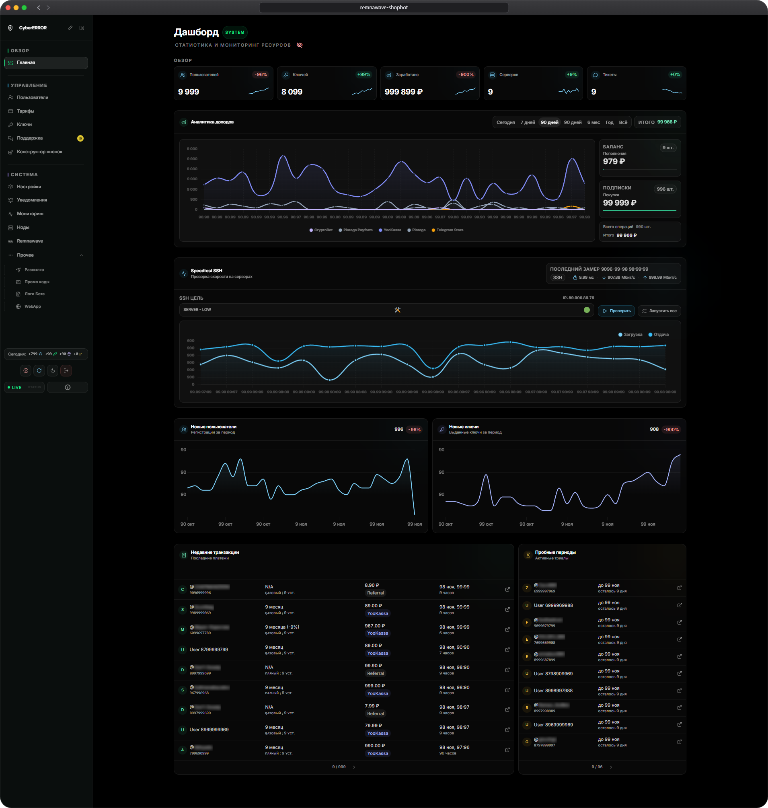
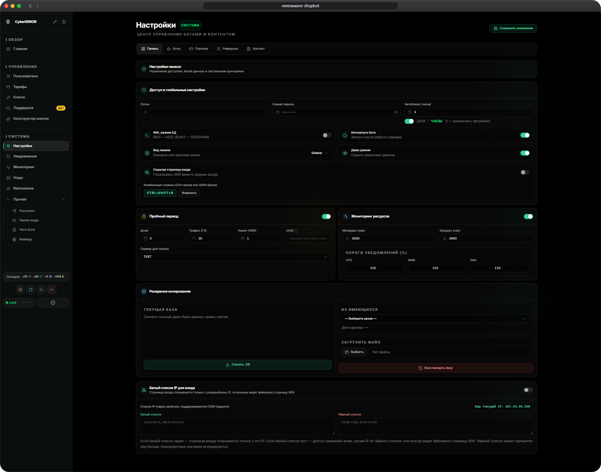
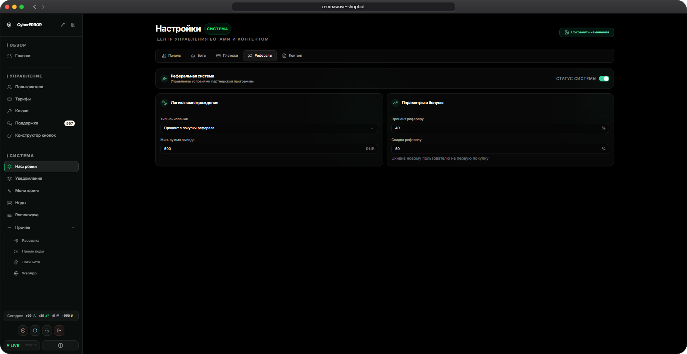
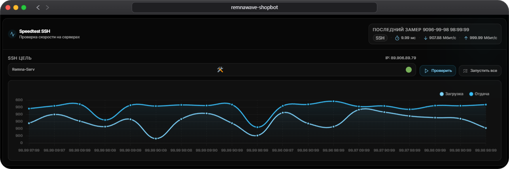
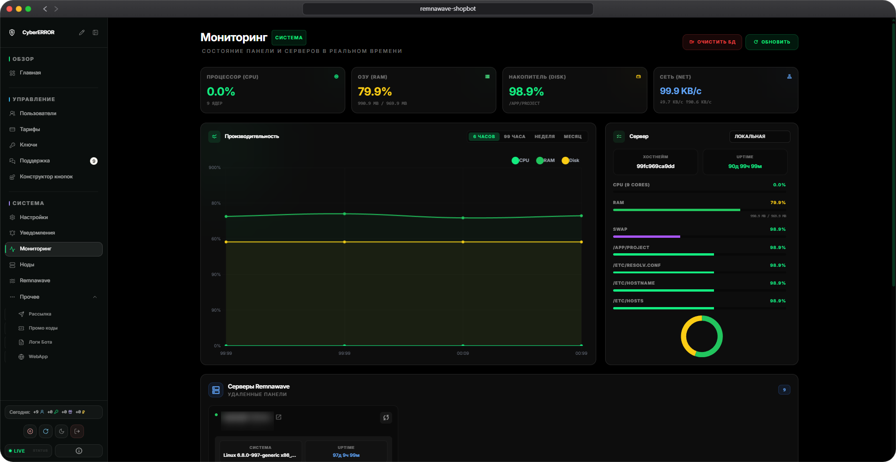
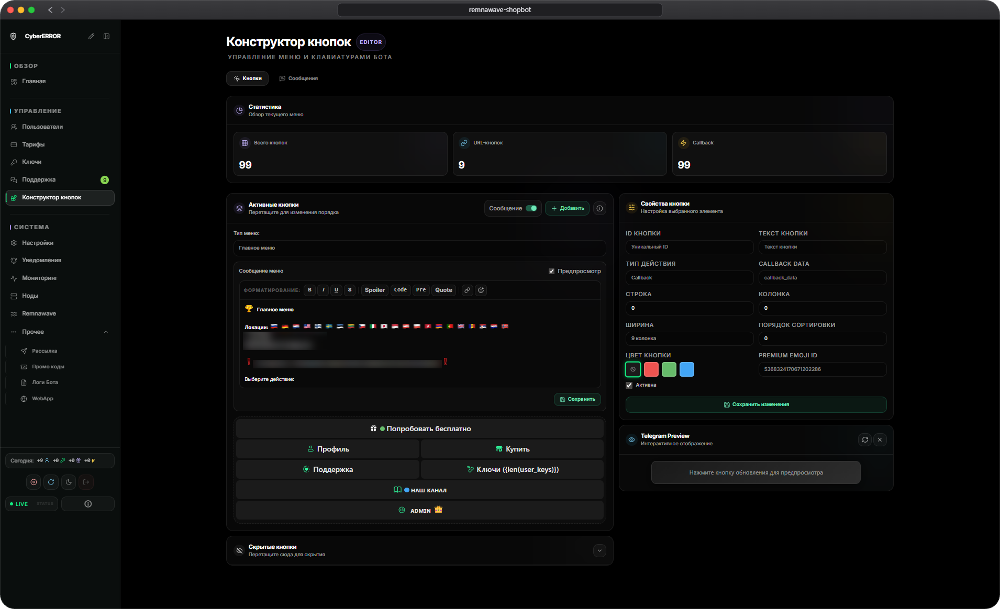
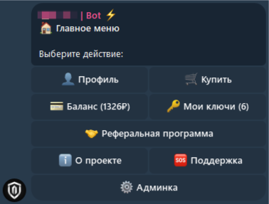
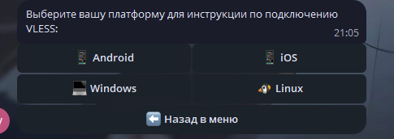
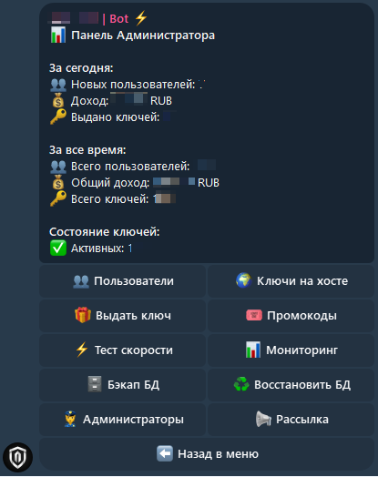
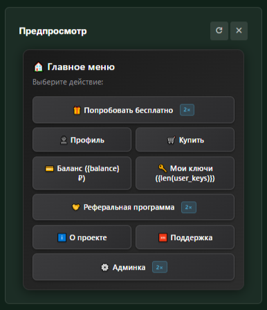

<!-- ═══════════════════════════  HEADER  ═══════════════════════════ -->
<div align="center">


<a href="https://github.com/CyberERROR/remnawave-shopbot">
  
</a>

<p>
  
</p>

[](https://github.com/CyberERROR/remnawave-shopbot/releases)
[](https://github.com/CyberERROR/remnawave-shopbot/releases)
[](https://github.com/CyberERROR/remnawave-shopbot/stargazers)
[](https://t.me/+YV_BO1cmGWw5OTdi)

[](https://www.python.org/downloads/)
[](#install)
[](LICENSE)
[](https://github.com/CyberERROR/remnawave-shopbot/commits)
[](https://github.com/CyberERROR/remnawave-shopbot/issues)


<br><br>

<table>
<tr>
<td align="center"><a href="#about"><b>📋<br>О проекте</b></a></td>
<td align="center"><a href="#screens"><b>🖼️<br>Скриншоты</b></a></td>
<td align="center"><a href="#install"><b>🚀<br>Установка</b></a></td>
<td align="center"><a href="#update"><b>🔄<br>Обновление</b></a></td>
<td align="center"><a href="#config"><b>⚙️<br>Настройка</b></a></td>
<td align="center"><a href="#payments"><b>💳<br>Платежи</b></a></td>
<td align="center"><a href="#modules"><b>🧩<br>Модули</b></a></td>
</tr>
</table>

</div>

<!-- ═══════════════════════════  ABOUT  ═══════════════════════════ -->
<a id="about"></a>

## 📋 О проекте

**Remnawave ShopBot** — комплексное решение для автоматизированной продажи VPN-конфигураций через Telegram: мощный бот + интуитивная веб-панель на базе **Tabler** для полного управления услугой.

<div align="center">

 ➜
 ➜
 ➜


<sub>🖥️ <b>Веб-панель</b> управляет тарифами, хостами и пользователями · 🌐 <b>Remnawave</b> выдаёт ключи</sub>

</div>

<table>
<tr>
<td width="50%" valign="top">

**🤖 Telegram-бот**
- ✅ Воронка продаж: онбординг → платёж → конфиг
- ✅ Админ-меню прямо в Telegram
- ✅ Принудительная подписка на канал/чат
- ✅ Техподдержка: внешний бот или контакт
- ✅ Конструктор кнопок интерфейса

</td>
<td width="50%" valign="top">

**🖥️ Веб-панель**
- ✅ Хосты, тарифы, пользователи, платежи
- ✅ Дашборд мониторинга статистики и событий
- ✅ Спидтесты: SSH-speedtest и Net-Probe
- ✅ Реферальная система с гибкими моделями
- ✅ 7 платёжных систем

</td>
</tr>
</table>

<div align="center">


</div>

<!-- ═══════════════════════════  SCREENSHOTS  ═══════════════════════════ -->
<a id="screens"></a>

## 🖼️ Скриншоты

<details>
<summary><b>📸 Показать</b> <sub>— клик по картинке откроет оригинал</sub></summary>
<br>

| 🖥️ Дашборд | ⚙️ Настройки | 🤝 Рефералы |
|:--:|:--:|:--:|
|  |  |  |
| 🧪 **Спидтесты** | 📈 **Мониторинг** | 🎨 **Конструктор кнопок** |
|  |  |  |

| 🏠 Главное меню | ❓ Настройки и помощь | 👑 Админ-меню | 👁️ Предпросмотр |
|:--:|:--:|:--:|:--:|
|  |  |  |  |

</details>

<!-- ═══════════════════════════  INSTALL  ═══════════════════════════ -->
<a id="install"></a>


> [!NOTE]
> **Что нужно заранее:** 🐧 Ubuntu 20.04+ / Debian 11+ · 🔑 SSH с правами `root` · 🌐 домен с A-записью на IP сервера · 📦 Remnawave Platform на целевых хостах · 💾 от 1 GB RAM и 10 GB диска


```bash
ssh root@your-server-ip
```


```bash
curl -sSL https://raw.githubusercontent.com/CyberERROR/remnawave-shopbot/main/install.sh | bash
```


| Вопрос | Пример | 💡 |
|:--|:--|:--|
| 🌐 Домен | `shop.example.com` | должен смотреть на этот сервер |
| 📧 Email | `you@example.com` | для SSL от Let's Encrypt |
| 🔌 Порт вебхуков | `8443` | 443 или 8443 — **рекомендуется 8443** |

Дальше всё автоматически: **Docker + Compose → Nginx (reverse proxy) → SSL через Certbot → контейнеры бота и панели → автообновление сертификата.**


```text
🎉 Установка завершена!
Веб-панель:  https://shop.example.com/login
Логин:       admin
Пароль:      admin
```

> [!CAUTION]
> Сразу смените пароль: **Настройки → Настройки панели**. Логин и пароль `admin` / `admin` знают все.

<!-- ═══════════════════════════  UPDATE  ═══════════════════════════ -->
<a id="update"></a>


> [!TIP]
> Обновление = **повторный запуск установщика**. Он скачивает свежую версию и пересобирает контейнеры.

&nbsp;
&nbsp;
&nbsp;


```bash
# 1. Подключиться к серверу
ssh root@your-server-ip

# 2. (по желанию) резервная копия папки проекта
cp -r /root/remnawave-shopbot /root/remnawave-shopbot.bak

# 3. Обновить до последней версии
curl -sSL https://raw.githubusercontent.com/CyberERROR/remnawave-shopbot/main/install.sh | bash

# 4. Убедиться, что всё поднялось
cd /root/remnawave-shopbot && docker-compose logs -f
```

<details>
<summary><b>♻️ Если что-то пошло не так — пересоздать контейнеры вручную</b></summary>

```bash
cd /root/remnawave-shopbot && docker-compose down && docker-compose up -d --build
```
</details>

<details>
<summary><b>🛠️ Шпаргалка по командам</b> <sub>(выполнять в <code>/root/remnawave-shopbot</code>)</sub></summary>
<br>

| Действие | Команда |
|:--|:--|
| 📜 Логи в реальном времени | `docker-compose logs -f` |
| 🔁 Перезапуск | `docker-compose restart` |
| ⏸️ Остановка (контейнеры остаются) | `docker-compose stop` |
| ⏹️ Остановка с удалением контейнеров | `docker-compose down` |
| ▶️ Запуск в фоне | `docker-compose up -d` |
| 🏗️ Пересборка и запуск | `docker-compose up -d --build` |
| 🧹 Очистка логов Docker | `truncate -s 0 /var/lib/docker/containers/*/*-json.log` |

</details>

<details>
<summary><b>🗑️ Полное удаление</b></summary>

> [!WARNING]
> Полностью удаляет бота и связанные контейнеры.

```bash
curl -sSL https://raw.githubusercontent.com/CyberERROR/remnawave-shopbot/main/uninstall.sh | bash
```
</details>

<!-- ═══════════════════════════  CONFIG  ═══════════════════════════ -->
<a id="config"></a>


<div align="center">

 ➜
 ➜
 ➜
 ➜


</div>

| | Шаг | Где в панели | Что сделать |
|:--:|:--|:--|:--|
| **1** | 🛡️ **Безопасность** | Настройки → Настройки панели | Войти на `https://domain.com/login` (`admin`/`admin`) и **сменить пароль** |
| **2** | 🤖 **Telegram-бот** | Настройки → Telegram параметры | **Токен** от [@BotFather](https://t.me/botfather) · **Имя** (username бота) · **ID админа** от [@userinfobot](https://t.me/userinfobot) |
| **3** | 🌐 **Хосты Remnawave** | Настройки → Управление хостами | **URL** `https://host.example.com:10443` · **API**-доступы · **SSH**: адрес, порт, юзер (для спидтеста) |
| **4** | 💳 **Тарифы** | Тарифы | Создать пакеты и сохранить все настройки |
| **5** | ▶️ **Запуск** | Шапка панели | Нажать **«Запустить бота»** — 🎊 бот принимает заказы! |

<!-- ═══════════════════════════  PAYMENTS  ═══════════════════════════ -->
<a id="payments"></a>


Включаются в **Настройки → Платёжные системы**.

| Система | Поля | Вебхук |
|:--|:--|:--|
| 🟡 **YooKassa** | `yookassa_shop_id` · `yookassa_secret_key` · почта для чеков *(опц.)* | `https://domain.com/yookassa-webhook` |
| 🔗 **Platega** | `Merchant ID` · `API Key` | `https://domain.com/platega-webhook` |
| 🤖 **CryptoBot** <sub>(Telegram Stars)</sub> | `cryptobot_token` — из `@CryptoBot` → **Crypto Pay** | `https://domain.com/cryptobot-webhook` <sub>включить в Crypto Pay</sub> |
| 💎 **Heleket** | `heleket_merchant_id` · `heleket_api_key` | ✖️ не требуется |
| ⚡ **TON Connect** <sub>(опц.)</sub> | `ton_wallet_address` — ваш кошелёк · `tonapi_key` — для актуальных курсов | — |

<!-- ═══════════════════════════  MODULES  ═══════════════════════════ -->
<a id="modules"></a>

## 🧩 Модули

<details>
<summary><b>🔗 Принудительная подписка</b> — <i>Настройки → Общие</i></summary>
<br>

| Параметр | Назначение |
|:--|:--|
| `force_subscription` | Включить обязательную подписку (`true` / `false`) |
| `channel_url` | Ссылка на канал/группу |
| `terms_url` | Условия использования |
| `privacy_url` | Политика конфиденциальности |

> [!IMPORTANT]
> Бот должен быть **администратором канала**, иначе не сможет проверить подписку.
</details>

<details>
<summary><b>🧪 Спидтесты и мониторинг</b> — <i>2 метода</i></summary>
<br>

| | 📊 SSH-Speedtest | 🌐 Net-Probe |
|:--|:--|:--|
| Что делает | `speedtest-cli` на удалённом сервере | Доступность и пинг по HTTP |
| Нужен SSH | ✅ да | ❌ нет |
| Скорость | полный замер | быстрее |
| Установка | автоустановка из админ-меню бота или панели | не нужна |

**Запуск:** 🤖 бот — `Админ-меню → Speedtest → Выбрать хост` · 🖥️ панель — `Дашборд → «Run speedtests»`

Результаты сохраняются в БД и видны на дашборде у каждого хоста.
</details>

<details>
<summary><b>🤝 Реферальная система</b> — <i>Настройки → Общие</i></summary>
<br>

| 💸 Типы начисления | ⚙️ Дополнительно |
|:--|:--|
| 📊 **Процент с покупки** реферала (например, 10%) | 🏷️ **Скидка реферала** — % для приглашённого |
| 💰 **Фиксированная сумма** за каждую покупку | 🏦 **Минимум вывода** средств |
| 🎁 **Бонус приглашающему** при регистрации | |

Рефссылка генерируется автоматически: `https://t.me/<bot_username>?start=ref_<telegram_id>`
</details>

<details>
<summary><b>🆘 Техническая поддержка</b> — <i>2 режима</i></summary>
<br>

| Режим | Параметры | Как работает |
|:--|:--|:--|
| 1️⃣ **Внешний саппорт-бот** | `support_bot_token` · `support_bot_username` · `support_text` (текст кнопки) | Кнопка «Помощь» ведёт в отдельного бота |
| 2️⃣ **Внешний контакт** | `support_user` (например, `@admin`) | Кнопка ведёт в личку контакту |
| 🧩 **Расширенно** | `support_forum_chat_id` | ID форума/топиков для сложных вопросов |
</details>

<!-- ═══════════════════════════  FOOTER  ═══════════════════════════ -->


Сначала загляните в [Issues](https://github.com/CyberERROR/remnawave-shopbot/issues) — возможно, это уже известно. Если нет — [создайте новый](https://github.com/CyberERROR/remnawave-shopbot/issues/new) и укажите: **📝 что произошло · 🔁 как воспроизвести · 💻 ОС и версию бота**.

## 📄 Лицензия

Распространяется по лицензии **[GPLv3](LICENSE)** — можно свободно использовать, изучать, модифицировать и распространять код при соблюдении условий лицензии.

<div align="center">

<br>

[](https://t.me/+YV_BO1cmGWw5OTdi)
[](https://github.com/CyberERROR/remnawave-shopbot)

**Сделано с ❤️ для сообщества** · <a href="#about">⬆️ Наверх</a>


</div>
